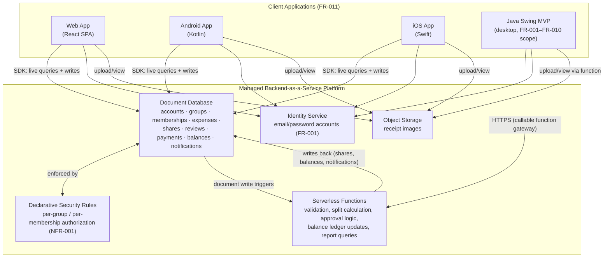
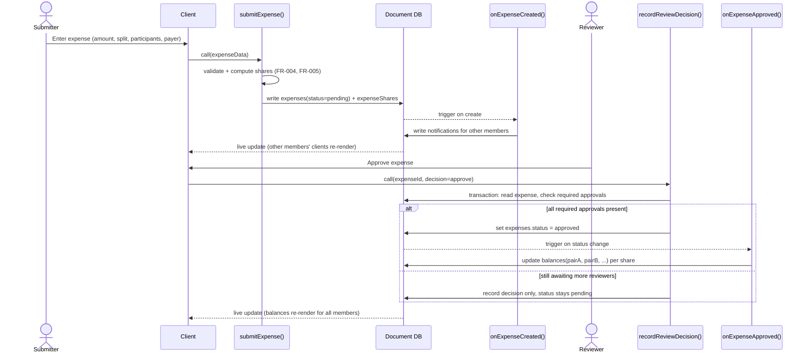
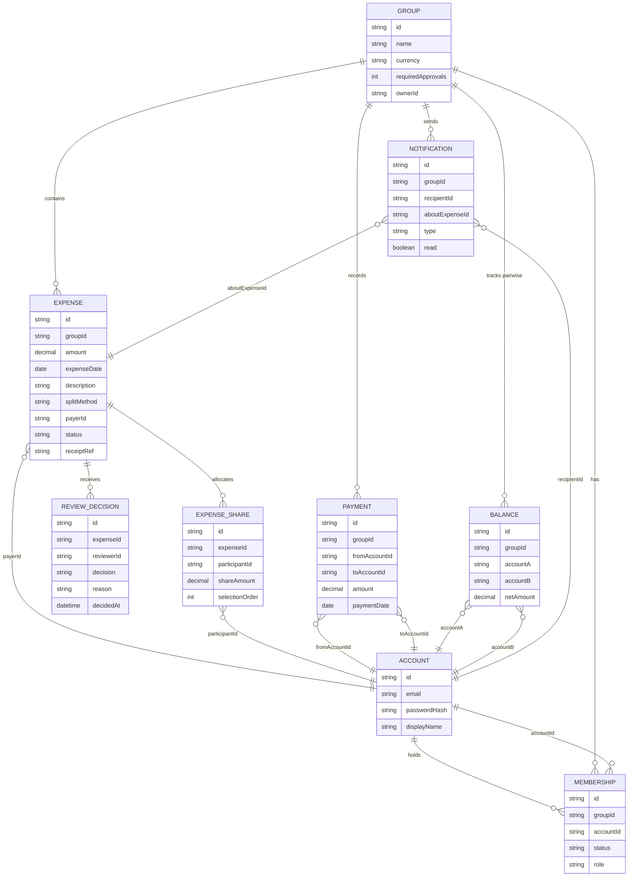

# SplitSmart — Alternative Architecture (Architecture 2)

> **Label**: This document is the **second, independently-designed alternative architecture** for SplitSmart, generated by **Claude Code**. It satisfies the same requirements in [`UserRequirement.md`](../UserRequirement.md) and [`specs/001-splitsmart-requirements/spec.md`](../specs/001-splitsmart-requirements/spec.md) but makes deliberately different structural choices than a conventional "client → REST API → relational database" design. It does not modify, replace, or reference the correctness of any other architecture document in this repository.

## 1. Approach and why it differs

Most natural first designs for SplitSmart converge on the same shape: thin clients, a stateless REST/JSON backend, a relational database, and an application-level notification loop. That is a perfectly valid architecture, but it is not the only one that satisfies the requirements.

This alternative instead uses a **serverless, event-driven, real-time-sync architecture** built on a managed Backend-as-a-Service (BaaS) platform (conceptually similar to Firebase/Supabase-class platforms). The core differences from the conventional approach:

| Dimension | Conventional choice | This architecture |
|---|---|---|
| Backend compute | Long-running application server (Spring/Express/etc.) | Small, independently deployed **serverless functions**, triggered by writes or by client calls |
| Data store | Relational DB with server-managed transactions | **Managed NoSQL document store** with declarative, per-document **security rules** and transactional writes scoped to related documents |
| Client/server communication | Client polls or calls REST endpoints | Clients hold **live subscriptions** to the data they're authorized to see; the store pushes updates to them |
| Notification delivery | Application code writes a "notifications" row and the client polls it | Notifications are **just another live-synced collection** — no separate delivery mechanism to build |
| Cross-client consistency (NFR-004) | Requires explicit cache invalidation / polling intervals | Falls out of the sync layer itself | 
| Authorization enforcement | Centralized in backend service code | Enforced **declaratively at the data layer** (security rules), independently re-checked by functions for business invariants |

This trades a conventional, fully self-hosted stack for less infrastructure to operate, near-real-time UX by default, and authorization rules that live next to the data instead of scattered across endpoint handlers — at the cost of vendor coupling and a different (non-SQL) way of thinking about multi-record consistency. Trade-offs are discussed in §8.

The design intentionally stays **no larger than SplitSmart needs**: there is no microservice mesh, no message broker, no Kubernetes cluster. "Serverless" here means a handful of small functions plus a managed database — appropriate for the scope in `UserRequirement.md` (a shared-expense tool for small/medium groups), not a large-scale distributed system.

## 2. High-level component view



**Why the Swing MVP client is drawn differently**: the spec explicitly scopes the Java Swing client to FR-001–FR-010 only, and does not require it to share the same real-time UX as the full product. Rather than embedding a full BaaS SDK in a desktop app, the MVP talks to the same functions and data through a thin HTTPS gateway — simpler to build, while still operating on the **same underlying accounts, groups, and balances** data the spec's open question #1 asks about (this design answers it: yes, one shared dataset, accessed through two different access paths).

## 3. Components and responsibilities

### 3.1 Clients (presentation only)
Web, Android, and iOS clients are intentionally "thin": they render data and submit user intent, but contain **no balance math, no approval logic, and no authorization decisions**. This avoids duplicating business rules three times across platforms (a real risk with FR-005's precise rounding rule and FR-008's pairwise-only netting rule). Each platform client:
- Authenticates via the Identity Service.
- Subscribes to the groups, expenses, balances, and notifications the current account is a member of.
- Submits commands (create expense, approve/reject, record payment) as document writes or function calls.
- Renders optimistic UI, reconciled against the authoritative server-computed result.

The Swing MVP follows the same principle but over plain HTTPS calls to callable functions instead of a live-sync SDK, since desktop Java has no first-class SDK for this class of platform.

### 3.2 Identity Service
Owns account registration and sign-in (FR-001) with email/password credentials. Issues a signed identity token consumed by both the security rules layer and the functions layer to identify the acting account on every request — this is the single source of truth for "who is making this request," used throughout authorization.

### 3.3 Document database (system of record)
Holds all durable state. Logical collections (detailed in §5):

`accounts`, `groups`, `memberships`, `expenses`, `expenseShares`, `reviewDecisions`, `payments`, `balances`, `notifications`.

Clients read most of this data **directly**, subject to security rules — there is no "API layer" standing between the UI and the data for reads. Writes that require business logic beyond a simple per-document rule (e.g., "percentages must sum to 100%, converted by largest-remainder rounding") go through functions instead of raw writes.

### 3.4 Declarative security rules (authorization boundary, NFR-001)
Every collection has rules evaluated by the platform on every read/write attempt, independent of any client-side code:
- A `groups/{groupId}` document and everything under it is readable only by accounts with an *active* `memberships` record for that group (membership status = `active`, i.e., invitation accepted) — directly satisfying FR-002's "access only after acceptance" rule and the "unrelated account cannot read group data" acceptance scenario.
- `expenses` and `expenseShares` are readable by group members only; writable only through functions (see below), not by direct client writes, so the split-calculation and validation rules cannot be bypassed by a modified client.
- `reviewDecisions` are writable only by accounts whose membership role includes `reviewer` for that group.
- `payments` are writable only by the account that is the paying party in a given pair.

This is a genuine architectural difference from a typical REST backend: authorization is **data-centric** (attached to what is being accessed) rather than **endpoint-centric** (attached to which URL handles the request). It removes an entire class of bug where one endpoint correctly checks authorization and a near-identical endpoint forgets to.

### 3.5 Serverless functions (business logic)
Stateless, independently deployable units, each with one responsibility — this is where FR-003–FR-010's actual logic lives:

| Function | Trigger | Responsibility |
|---|---|---|
| `submitExpense` | Callable (client-invoked) | Validates amount > 0, date, description, participants, payer-is-participant (FR-004); computes shares using the largest-fractional-remainder rule (FR-005); writes `expenses` + `expenseShares` as pending |
| `onExpenseCreated` | Triggered by new `expenses` doc | Fans out `notifications` documents to other active group members (FR-006) |
| `recordReviewDecision` | Callable | Validates reviewer authorization; records approve/reject; if group requires multiple review levels, checks whether all required approvals are now present before marking the expense `approved` (FR-007); runs inside a database transaction keyed on the expense so two simultaneous reviewer actions cannot both apply a balance change (addresses the "two reviewers act on the same expense" edge case) |
| `onExpenseApproved` | Triggered by `expenses.status → approved` | Applies each `expenseShares` entry to the relevant pairwise `balances` document, scoped strictly to the two members in each share (FR-008) |
| `recordPayment` | Callable | Validates the payment does not exceed the pair's current outstanding balance (rejects otherwise, per the edge case); writes `payments`; updates the pairwise `balances` document once (FR-009) |
| `getReport` | Callable | Runs an authorized, date-ranged aggregation over `expenses`, `expenseShares`, and `payments` for a group/account and returns summarized totals (FR-010) |

Each function re-validates authorization itself in addition to the security rules — a deliberate defense-in-depth choice, since security rules alone cannot easily express multi-step invariants like "shares must sum exactly to the total" or "only the first valid review decision counts."

### 3.6 Object storage
Receipt images (FR-003) are stored in object storage keyed by expense ID, with access rules mirroring the owning expense's group membership check. The `expenses` document stores a reference (path/URL), not the binary.

## 4. Key data flows (sequence diagrams)

### 4.1 Submit → notify → review → balance update (User Stories 2–4)



### 4.2 Payment recording (User Story 4, with rejection edge case)

```mermaid
sequenceDiagram
    actor Payer
    participant Client
    participant recordPayment as recordPayment()
    participant DB as Document DB

    Payer->>Client: Record payment (recipient, amount)
    Client->>recordPayment: call(recipientId, amount, date)
    recordPayment->>DB: read current pairwise balance
    alt amount <= outstanding balance
        recordPayment->>DB: write payments; update balances (once)
        DB-->>Client: live update, decreased balance shown
    else amount > outstanding balance
        recordPayment-->>Client: rejected with explanation
    end
```

## 5. Data model

Although the store is a document database, the logical schema is shown as an ER diagram for clarity — each box is a collection, and relationships are reference fields (document IDs), not foreign-key joins.



Notes on design choices in this schema:
- **`balances` is a materialized, denormalized collection**, not computed on read. It is maintained exclusively by `onExpenseApproved` and `recordPayment`, which is what keeps pairwise reads fast (a single document fetch) and keeps FR-008's "no offsetting through third members" rule simple — each `balances` document is scoped to exactly one pair and nothing else ever writes to it.
- **`expenseShares` is a separate collection from `expenses`**, each a reference rather than an embedded array, so that security rules and queries for "all my shares across groups" (needed for reports, FR-010) don't require scanning every expense document.
- **`selectionOrder` on `expenseShares`** directly encodes the tie-break rule from FR-005/NFR-002 (largest-remainder rounding, ties broken by participant selection order), so the rounding rule is reproducible and auditable from stored data alone, not just from transient calculation.
- Removing a member sets their `memberships.status` to `removed` rather than deleting the document, preserving historical expenses/decisions/payments as required by the spec's edge cases.

## 6. Mapping to requirements

| Requirement | Satisfied by |
|---|---|
| FR-001 (accounts) | Identity Service + `accounts` collection |
| FR-002 (groups, invite/accept) | `groups` + `memberships` (status transitions from `invited` → `active`), enforced by security rules |
| FR-003/FR-004 (expense entry, payer/participants) | `submitExpense()` validation |
| FR-005 (split calculation) | `submitExpense()` largest-remainder algorithm, auditable via `expenseShares.selectionOrder` |
| FR-006 (notifications) | `onExpenseCreated()` → `notifications` collection, live-synced to clients |
| FR-007 (review/approval, multi-level) | `recordReviewDecision()` transactional approval counting against `groups.requiredApprovals` |
| FR-008 (pairwise balances) | `onExpenseApproved()` + `balances` collection, strictly pair-scoped |
| FR-009 (payments) | `recordPayment()` with outstanding-balance validation |
| FR-010 (reports) | `getReport()` authorized, date-ranged aggregation |
| FR-011 (web/Android/iOS) | Three platform clients against the same data/functions layer |
| NFR-001 (authorization) | Security rules (data-centric) + per-function re-validation |
| NFR-002 (exact-sum rounding) | Same largest-remainder algorithm, shared by one function implementation |
| NFR-004 (cross-client consistency) | Live-sync subscriptions push changes to all connected clients, typically sub-second — well inside the 10-second target |
| NFR-003 (response time under load) | Managed platform auto-scales function instances and database throughput without capacity planning |

## 7. Security, scalability, maintainability, deployment

**Security**: Authorization is enforced twice — declaratively at the data layer (security rules) and procedurally inside each function — so a bug in one layer does not by itself expose data (addresses NFR-001 defense-in-depth). All business-sensitive writes (expense creation, approval, balance changes, payments) are *only* reachable through functions, never raw client writes, closing off client-side tampering with amounts or statuses.

**Scalability**: Functions are stateless and scale per-invocation; the document database scales horizontally by key (group/account), which matches SplitSmart's access pattern (almost all reads/writes are scoped to one group or one account pair). This comfortably covers the 100-concurrent-user NFR-003 target without dedicated capacity planning, and would also scale well past it if needed.

**Maintainability**: Each function has one responsibility and can be modified, tested, and deployed independently (e.g., changing the rounding rule only touches `submitExpense`). Business logic lives in exactly one place per concern, rather than being re-implemented per client platform. The main maintainability cost is that logical schema changes (e.g., adding a field) require coordinating security rules, functions, and all three client SDKs, since there is no versioned API contract layer — mitigated by keeping client reads limited to well-defined collections, and routing all writes through functions, which are easy to version independently of clients.

**Deployment**: A CI pipeline deploys three independently versionable units — security rules, functions, and the web static bundle — to the managed platform; mobile apps follow normal app-store release cycles; the Swing MVP is distributed as a runnable JAR configured with the functions gateway URL. There is no server fleet, container orchestration, or database administration to operate — the managed platform owns patching, backups, and scaling of the database and function runtime.

## 8. Advantages, disadvantages, trade-offs, and limitations

**Advantages**
- Real-time cross-client consistency (NFR-004) and in-app notifications (FR-006) are side effects of the sync layer, not features that must be separately engineered.
- Authorization rules live beside the data they protect, reducing the chance of an endpoint that forgets to check membership.
- Minimal operational surface: no servers to patch, size, or keep available — well matched to a small team building a product of SplitSmart's scope.
- Clear separation of "thin client, shared logic in functions" avoids re-implementing the rounding/approval rules per platform.

**Disadvantages / trade-offs**
- **Vendor coupling**: the architecture leans on a specific class of managed platform (security rules language, document DB semantics, function runtime). Migrating providers later is a larger undertaking than swapping a SQL database behind a REST API.
- **Multi-document consistency is manual**: unlike a relational database's multi-table ACID transactions, keeping `expenses`, `expenseShares`, and `balances` consistent across collections requires explicit transactional functions (as designed in §3.5) rather than getting it for free from the database engine; this is manageable at SplitSmart's scale but is a real cognitive cost compared to SQL transactions.
- **Complex reporting is harder**: ad hoc, multi-condition date-range reports (FR-010) across several collections are more naturally expressed in SQL than in a document query API; `getReport()` needs to be written and indexed carefully as report needs grow (e.g., additional filters), whereas a relational schema would let that evolve more flexibly via new queries alone.
- **The desktop MVP is architecturally the odd one out**: because Java has no first-class SDK for this class of platform, the Swing client talks through a thin HTTPS gateway rather than getting live-sync "for free" like the other three clients — acceptable since the spec does not require the MVP to meet the full product's cross-client real-time experience, but it is an asymmetry worth naming.

**Limitations**
- This architecture assumes the chosen managed platform's security-rule language is expressive enough for group-based authorization (true for the mainstream options) — a platform without flexible per-document rules would weaken NFR-001 enforcement and push more logic back into functions.
- Very large report queries (e.g., very long date ranges across many groups) may need additional materialized/aggregated collections over time to stay within NFR-003's latency target, since document databases generally favor pre-aggregation over large ad hoc scans.
