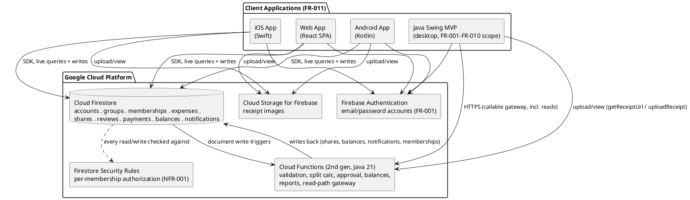
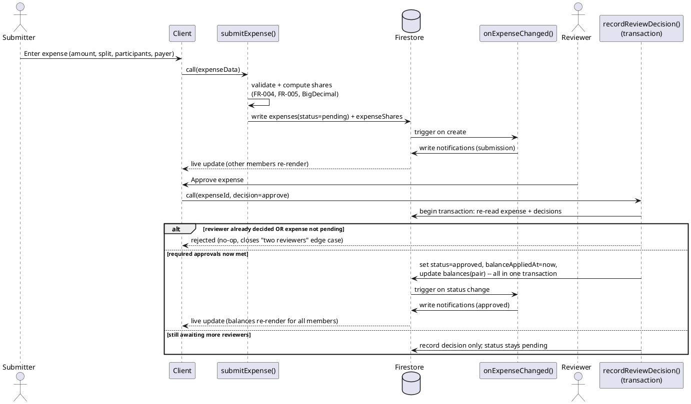
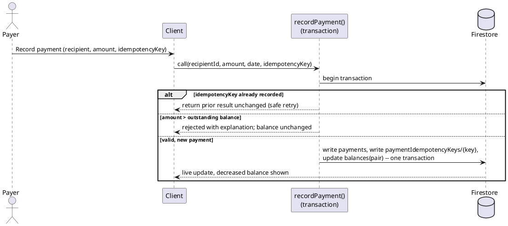
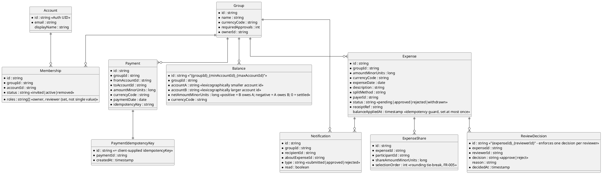

# SplitSmart — Alternative Architecture (Architecture 2)

> **Label**: This document is the **second, independently-designed alternative architecture** for SplitSmart, generated by **Claude Code**. It satisfies the same requirements in [`UserRequirement.md`](../UserRequirement.md) and [`specs/001-splitsmart-requirements/spec.md`](../specs/001-splitsmart-requirements/spec.md) but makes deliberately different structural choices than a conventional "client → REST API → relational database" design. It does not modify, replace, or reference the correctness of any other architecture document in this repository.
>
> **Revision note**: This revision incorporates a correctness/security/consistency review of the first draft — specifically: idempotent balance application, a resolved rules-vs-functions contradiction, explicit membership write authority, the missing group-management and read-path functions, payment idempotency, data-model fixes (no stored passwords, integer minor units, a defined balance sign convention, reviewer-decision uniqueness), a named concrete platform, the spec's missing edge cases (edit/withdraw, report date validation, status-change notifications, multi-level rejection), and explicit alignment with `.specify/memory/constitution.md`. Per Constitution Principle X, this AI-generated document still requires human review and project-owner approval before adoption.

## 1. Approach and why it differs

Most natural first designs for SplitSmart converge on the same shape: thin clients, a stateless REST/JSON backend, a relational database, and an application-level notification loop. That is a perfectly valid architecture, but it is not the only one that satisfies the requirements.

This alternative instead uses a **serverless, event-driven, real-time-sync architecture** on a named managed platform: **Google Cloud Platform**, specifically **Firebase Authentication**, **Cloud Firestore**, **Cloud Functions (2nd generation, Java 21 runtime)**, and **Cloud Storage for Firebase**. The core differences from the conventional approach:

| Dimension | Conventional choice | This architecture |
|---|---|---|
| Backend compute | Long-running application server (Spring/Express/etc.) | Small, independently deployed **Java 21 Cloud Functions**, triggered by writes or by client calls |
| Data store | Relational DB with server-managed transactions | **Cloud Firestore** (document store) with declarative **Firestore Security Rules** and bounded multi-document transactions |
| Client/server communication | Client polls or calls REST endpoints | Web/Android/iOS hold **live Firestore listeners**; the Swing MVP calls the same functions through an HTTPS gateway (see §3.5) |
| Notification delivery | Application code writes a "notifications" row and the client polls it | Notifications are **just another live-synced collection** — no separate delivery mechanism to build |
| Cross-client consistency (NFR-004) | Requires explicit cache invalidation / polling intervals | Falls out of the sync layer itself |
| Authorization enforcement | Centralized in backend service code | Enforced **declaratively at the data layer** (Firestore Security Rules) for reads, and **exclusively inside functions** for all writes that affect money or status (§3.4) |

This trades a conventional, fully self-hosted stack for less infrastructure to operate, near-real-time UX by default, and authorization rules that live next to the data instead of scattered across endpoint handlers — at the cost of vendor coupling, Firestore's bounded transaction model, and JVM cold-start latency on functions (§7, §12). The design stays no larger than SplitSmart needs: there is no microservice mesh, no message broker, no Kubernetes cluster — a handful of small Java functions plus a managed database, appropriate for a shared-expense tool for small/medium groups.

## 2. High-level component view

**Why the Swing MVP client is drawn differently**: the spec scopes the Java Swing client to FR-001–FR-010 only. Rather than embedding a Firestore SDK in a desktop app, the MVP calls the **same Cloud Functions** for both writes and reads (§3.5) — one uniform HTTPS contract for the MVP, instead of teaching it Firestore's native SDK/rules/token-refresh model for an experience the spec does not require to be real-time. Both paths operate on the **same underlying Firestore project** (resolving the spec's open question #1: one shared dataset, two access paths).

## 3. Components and responsibilities

### 3.1 Clients (presentation only)

Web, Android, and iOS clients are intentionally thin: they render data and submit user intent, but contain **no balance math, no approval logic, and no authorization decisions** — that logic exists exactly once, in the Java functions (§3.5), avoiding three divergent reimplementations of FR-005's rounding rule and FR-008's pairwise-only netting rule. Each platform client authenticates via Firebase Authentication, subscribes to the groups/expenses/balances/notifications the signed-in account is a member of, and submits commands through either a direct (rules-gated) Firestore write for non-sensitive profile fields or a Cloud Function call for anything financial or status-changing.

The Swing MVP follows the same "no business logic in the client" principle, calling read and write functions over HTTPS instead of holding a live-sync SDK connection (§3.5).

### 3.2 Firebase Authentication (identity)

Owns account registration and sign-in (FR-001) with email/password credentials and issues a signed ID token, which both Firestore Security Rules and Cloud Functions use as the authoritative "who is making this request" on every operation. **Credentials are never stored in Firestore or by application code** — Authentication owns and manages them internally. An `onAccountCreated` Auth trigger function writes a minimal `accounts` profile document (`id` = Auth UID, `email`, `displayName`) on first sign-up; no password material is ever mirrored into the data layer.

### 3.3 Cloud Firestore (system of record)

Holds all durable state (collections detailed in §5): `accounts`, `groups`, `memberships`, `expenses`, `expenseShares`, `reviewDecisions`, `payments`, `paymentIdempotencyKeys`, `balances`, `notifications`.

Web/Android/iOS clients read most of this data **directly** (subject to rules); the Swing MVP reads it through dedicated read functions (§3.5). Writes to anything affecting money, approval status, or group membership are **never** performed directly by any client — they go exclusively through Cloud Functions (§3.4, §3.5).

### 3.4 Firestore Security Rules (authorization boundary, NFR-001)

Rules are evaluated on every attempted read/write, independent of client code:

- A `groups/{groupId}` document and everything under it is **readable** only by accounts with an *active* `memberships` record for that group — directly satisfying FR-002's "access only after acceptance" and the "unrelated account cannot read group data" acceptance scenario.
- `accounts/{accountId}` is readable only by that same account (`request.auth.uid == accountId`); there is no client-reachable way to list or search accounts by email (see `inviteMember` in §3.5 for how invites still work without exposing this collection).
- **All client writes are denied** — without exception — to `expenses`, `expenseShares`, `reviewDecisions`, `payments`, `paymentIdempotencyKeys`, `balances`, and `memberships`. Rules for these collections are `allow read: if <membership check>; allow write: if false;`. Every mutation to these collections is performed exclusively by Cloud Functions using the Admin SDK, which operates with elevated privileges and is not subject to these client-facing rules.

This resolves a contradiction in the previous draft, where §3.4 appeared to let clients write `payments` and `reviewDecisions` directly while §7 said all such writes went through functions. **Functions-only is the single source of truth for every write in this list; rules exist here only to gate reads.** This is still a genuine difference from a typical REST backend: read authorization is **data-centric** (attached to what is being accessed), while write authorization and business invariants are centralized in one Java codebase (the functions), not scattered across endpoint handlers.

### 3.5 Cloud Functions (business logic, Java 21 runtime, Maven build)

Stateless, independently deployable, each with one responsibility. All are implemented in Java 21, built and packaged with Maven, and unit/integration tested with JUnit 5 (§8), satisfying Constitution Principles I, II, and IV for this part of the codebase.

**Account and group management**

| Function | Trigger | Responsibility |
|---|---|---|
| `onAccountCreated` | Firebase Auth user-created event | Writes the `accounts` profile doc (no credentials) |
| `createGroup` | Callable | Creates `groups` doc; creates the creator's own `memberships` doc with `roles=["owner","reviewer"]`, `status=active` |
| `inviteMember` | Callable (owner only) | Looks up the target account **server-side, with Admin-SDK privileges**, by email (an index not exposed to any client query); creates a `memberships` doc with `status=invited`. The `accounts` collection itself remains unreadable to anyone but its own owner (§3.4) |
| `respondToInvite` | Callable (invitee only) | Transitions the invitee's own `memberships.status` from `invited` to `active`. No other account may change this document |
| `removeMember` | Callable (owner only) | Sets `memberships.status = removed`. Historical expenses/decisions/payments and their balance effects are left untouched (per the spec's removal edge case) |
| `setReviewers` / `setRequiredApprovals` | Callable (owner only) | Updates a member's `roles` array or the group's `requiredApprovals` count |

This closes the previous draft's gap where FR-002 (group creation, invite, accept) had no implementation path, and explicitly answers "who may write `memberships`": **only these functions, each restricted to a specific actor and a specific state transition.**

**Expense lifecycle**

| Function | Trigger | Responsibility |
|---|---|---|
| `submitExpense` | Callable | Validates amount > 0, date, description, participants, payer-is-participant (FR-004); computes shares with the largest-fractional-remainder rule (FR-005); writes `expenses` (status=`pending`) + `expenseShares` |
| `editExpense` | Callable (submitter or owner) | Re-validates and recomputes shares for a `pending` expense (stays `pending`, per the spec's edit edge case). If the target expense is currently `approved`, the same transaction **first reverses its previously applied balance deltas** (using the stored `balanceAppliedAt`/share data), then sets status back to `pending` and clears `balanceAppliedAt` — so an edited approved expense has zero balance effect until re-approved, exactly as the spec's edge case requires |
| `withdrawExpense` | Callable (submitter or owner) | Sets a `pending` expense to `withdrawn` (excluded from balances; terminal state). *Implementation decision* (Constitution Principle IX): the spec does not name a withdraw action explicitly, but its edit edge case implies submitters can correct mistakes before review, so a narrow "cancel before review" action is included rather than invented approval/rejection semantics |
| `onExpenseChanged` | Triggered on `expenses` create or `status` field change | Fans out `notifications` for: new submission (FR-006), and separately for the expense becoming `approved` or `rejected` (closes the previous draft's gap where only submission produced a notification) |
| `recordReviewDecision` | Callable (reviewer role only), Firestore transaction | Re-checks reviewer authorization inside the transaction; rejects outright if a decision for `{expenseId, reviewerId}` already exists (uniqueness, see §5) or if the expense is no longer `pending` (closes the "two reviewers / later decision" edge case — the transaction's re-read of `expenses.status` is the guard). On **reject**: sets `status=rejected`, stores the reason, short-circuits further voting — *implementation decision*: any single required reviewer's rejection finalizes the expense as rejected immediately, rather than waiting for all reviewers, since the spec's edge case only describes "the first valid decision" governing status, and a rejection is itself that first valid decision. On **approve**: counts recorded approvals against `groups.requiredApprovals`; once met, applies the balance update **in the same transaction** (see idempotency note below) and sets `status=approved` |

**Idempotent balance application** (fixes the previous draft's at-least-once trigger risk): balance changes are **no longer applied by a separate triggered function**. They are applied inside `recordReviewDecision`'s own transaction, guarded by checking/setting an `expenses.balanceAppliedAt` timestamp as part of that same atomic write — if it is already set, the transaction does not re-apply the delta. Because Firestore transactions are atomic and this function is the only writer of `balances` on the approval path, a balance can be applied at most once per approval, and `onExpenseChanged` now exists purely for notifications and carries no financial side effect, so its own at-least-once trigger semantics are harmless (a duplicate notification document is a cosmetic risk, not a correctness one).

**Payments**

| Function | Trigger | Responsibility |
|---|---|---|
| `recordPayment` | Callable, Firestore transaction, client-supplied `idempotencyKey` | Inside one transaction: checks whether `paymentIdempotencyKeys/{idempotencyKey}` already exists — if so, aborts and returns the prior result unchanged (safe retry/double-click); otherwise reads the pair's current `balances` doc, rejects if `amount > outstanding` (per the spec's edge case), and if valid writes `payments`, writes the `paymentIdempotencyKeys/{idempotencyKey}` marker, and updates `balances` — all atomically, so a payment is applied exactly once even under retries or near-simultaneous double submission |

**Reports**

| Function | Trigger | Responsibility |
|---|---|---|
| `getReport` | Callable | Rejects immediately if `startDate > endDate` (the spec's date-range edge case). Otherwise returns, for the authorized scope: (a) **period activity** — approved expenses, `expenseShares`, and `payments` dated within `[startDate, endDate]`, aggregated per pair, which is the *net change in balance caused by that period's activity*; and (b) **current balances** — the live `balances` snapshot as of now, clearly labeled as "as of today," not as of the period end. Separating these two explicitly resolves the ambiguity in the previous draft between "balances" meaning a running total versus a period's net change — both are returned, distinctly labeled |

**Read path (Swing MVP and general query needs)**

| Function | Trigger | Responsibility |
|---|---|---|
| `listGroups`, `listExpenses`, `getBalances`, `listNotifications` | Callable | Authorized reads scoped to the caller's own memberships, mirroring exactly what the Firestore rules in §3.4 would allow a direct read to return |
| `getReceiptUrl` / `uploadReceipt` | Callable | Issues a short-lived signed URL for Cloud Storage reads, or accepts an upload and stores it keyed by expense ID, so the Swing MVP never needs direct Cloud Storage credentials |

**Documented choice**: the previous draft left the Swing MVP with no way to read anything (it only called functions, and no read functions existed) and no function behind "upload/view via function." Rather than teaching the desktop client Firestore's native REST+rules dialect and ID-token refresh handling, the MVP uses the **same callable-function gateway for both reads and writes** — one protocol, one client library, consistent with how the MVP already reaches the platform for writes.

### 3.6 Cloud Storage for Firebase

Receipt images (FR-003) are stored keyed by expense ID. Storage security rules mirror the owning expense's group-membership check for Web/Android/iOS; the Swing MVP instead goes through `getReceiptUrl`/`uploadReceipt` (§3.5), so it never needs its own Storage credentials.

## 4. Key data flows

### 4.1 Submit → notify → review → idempotent balance update (User Stories 2–4)

### 4.2 Payment recording with idempotency (User Story 4, edge case: duplicate/invalid payment)

## 5. Data model

Notes on the fixes applied to this schema:
- **No `passwordHash` anywhere** — credentials live only inside Firebase Authentication; `accounts` is a profile mirror only.
- **`roles` is an array**, not a single `role` string, because one account can be both `owner` and `reviewer` on the same group.
- **`balances` has a canonical pair key and a defined sign convention** (`id = "{groupId}_{min(idA,idB)}_{max(idA,idB)}"`, `netAmountMinorUnits` positive meaning `accountB` owes `accountA`), so every function that touches a pair's balance computes the same document ID and the same sign — removing the ambiguity in the previous draft.
- **`reviewDecisions` IDs are `"{expenseId}_{reviewerId}"`**, so a reviewer attempting a second decision collides with their own existing document; `recordReviewDecision` treats that collision as "already decided" rather than allowing a second, conflicting write.
- **All money fields are integer minor units** (`...MinorUnits`, e.g. cents) plus a `currencyCode`, not `decimal`/floating types — Firestore has no exact decimal type, so storing floating-point numbers would risk the exact-sum guarantee in NFR-002. `BigDecimal` is still used for the *calculation* inside Java functions (rounding, largest-remainder allocation per FR-005), and the result is converted to an exact integer minor-unit value before being persisted — satisfying Constitution Principle VIII (BigDecimal for monetary calculation, no binary floating point) end to end.
- **`paymentIdempotencyKeys`** is a new collection whose document ID is the client-supplied idempotency key, written atomically alongside the payment it corresponds to, giving `recordPayment` an exactly-once guarantee under retries.
- Removing a member sets `memberships.status = removed` rather than deleting the document, preserving historical expenses/decisions/payments as the spec's edge cases require.

## 6. Mapping to requirements

| Requirement | Satisfied by |
|---|---|
| FR-001 (accounts) | Firebase Authentication + `onAccountCreated` + `accounts` collection (no stored credentials) |
| FR-002 (groups, invite/accept) | `createGroup`, `inviteMember`, `respondToInvite`, `removeMember`, `setReviewers`/`setRequiredApprovals` — all function-only writes to `memberships` |
| FR-003/FR-004 (expense entry, payer/participants) | `submitExpense()` validation; `editExpense()` for the spec's edit edge case |
| FR-005 (split calculation) | `submitExpense()` largest-remainder algorithm (BigDecimal calculation → integer minor units), auditable via `expenseShares.selectionOrder` |
| FR-006 (notifications) | `onExpenseChanged()` → `notifications`, firing on submission **and** on approval/rejection |
| FR-007 (review/approval, multi-level) | `recordReviewDecision()` transactional approval counting against `groups.requiredApprovals`, with an explicit (flagged) short-circuit rule for rejection |
| FR-008 (pairwise balances) | Balance update applied inside `recordReviewDecision`'s own transaction, idempotent via `balanceAppliedAt`, strictly pair-scoped via the `balances` canonical key |
| FR-009 (payments) | `recordPayment()` — transactional, idempotency-key guarded, outstanding-balance validated |
| FR-010 (reports) | `getReport()` — date-range validated, returns both period activity and current balances, clearly labeled |
| FR-011 (web/Android/iOS) | Three platform clients against the same Firestore/Functions layer |
| NFR-001 (authorization) | Firestore Security Rules (reads) + functions-only writes with per-function re-validation (§3.4) |
| NFR-002 (exact-sum rounding) | Shared largest-remainder algorithm; integer minor-unit storage removes floating-point risk |
| NFR-003 (response time under load) | Managed autoscaling (§7); explicit cold-start mitigation for the two latency-sensitive write paths (§12) |
| NFR-004 (cross-client consistency) | Live Firestore listeners push changes to all connected clients, typically sub-second |
| NFR-005 (accessibility) | Per-client native accessibility support (§9) |
| AC-001 (FR-001) | Unique-email registration enforced by Firebase Authentication; `accounts/{id}` readable only by its own owner |
| AC-002 (FR-002) | `inviteMember` + `respondToInvite`; membership `status=active` required by rules before any group read succeeds |
| AC-003 (FR-003) | `submitExpense` rejects incomplete/invalid input before any document is written |
| AC-004 (FR-004) | `submitExpense` payer-is-participant check; default payer = submitter when they are a participant |
| AC-005 (FR-005) | Largest-fractional-remainder allocation with `selectionOrder` tie-break; non-100% totals rejected |
| AC-006 (FR-006) | `onExpenseChanged` writes `notifications` scoped to active members only (rules deny reads to non-members) |
| AC-007 (FR-007) | Only `recordReviewDecision`, restricted to `roles` containing `reviewer`, can change `expenses.status` |
| AC-008 (FR-008) | `balances` canonical pair key + sign convention; `balanceAppliedAt` idempotency guard; pending/rejected/withdrawn expenses never written to `balances` |
| AC-009 (FR-009) | `recordPayment` idempotency-key + outstanding-balance check, single atomic transaction |
| AC-010 (FR-010) | `getReport` start/end validation and authorized, membership-scoped aggregation |
| AC-011 (FR-011) | Three platform clients, one shared Firestore/Functions backend |

## 7. Security, scalability, maintainability, deployment

**Security**: Authorization is enforced twice — declaratively at the data layer for reads (Firestore Security Rules) and procedurally inside each function for writes and business invariants. All financially or status-sensitive writes are reachable **only** through functions (§3.4), closing off client-side tampering with amounts, splits, or approval status. Reviewer-decision uniqueness and payment idempotency are enforced structurally (document-ID collision, idempotency-key collision) rather than relying on client good behavior.

**Scalability**: Functions are stateless and scale per-invocation; Firestore scales horizontally by key (group/account), matching SplitSmart's access pattern of mostly single-group/single-pair reads and writes. This comfortably covers the 100-concurrent-user NFR-003 target without dedicated capacity planning.

**Maintainability**: Each function has one responsibility and can be modified, tested, and deployed independently (e.g., changing the rounding rule only touches `submitExpense`). The main maintainability cost is that schema changes require coordinating rules, functions, and client SDKs, since there is no versioned API contract layer — mitigated by routing all sensitive writes through functions (one place to version) and keeping direct client reads limited to well-defined, rules-gated collections.

**Deployment**: A CI pipeline builds the Java functions with Maven, deploys them (`gcloud functions deploy --runtime=java21`), deploys Firestore Security Rules, and deploys the web static bundle, as three independently versionable units; mobile apps follow normal app-store release cycles; the Swing MVP is distributed as a Maven-built runnable JAR configured with the functions gateway URL. There is no server fleet, container orchestration, or database administration to operate.

## 8. Testing strategy

Satisfies Constitution Principle IV (JUnit 5 verification) for the Java portions of this architecture:

- **Function unit tests (JUnit 5)**: the largest-fractional-remainder split algorithm, the balance sign-convention arithmetic, the idempotency-guard logic (`balanceAppliedAt`, `paymentIdempotencyKeys`), and report date-range validation are tested as plain Java methods, independent of Firestore, wherever the logic can be isolated from the SDK calls.
- **Emulator-based integration tests**: the Firebase Local Emulator Suite runs Firestore (with the real Security Rules) and Cloud Functions locally, so rules tests (e.g., "a non-member cannot read `expenses`," "a client write to `balances` is always denied") and function integration tests (e.g., "two concurrent `recordReviewDecision` calls on the same expense apply the balance exactly once") run against real rule evaluation and real transaction semantics, not mocks.
- **Swing MVP business-layer tests (JUnit 5)**: the MVP's service layer (the class wrapping gateway calls, per §10) is tested independent of any Swing component, per Constitution Principle VII.

## 9. Accessibility (NFR-005)

Each delivered client meets NFR-005 using its platform's native accessibility stack rather than a bespoke solution: the web app uses semantic HTML, ARIA attributes, and full keyboard navigation (targeting WCAG 2.1 AA); Android uses standard accessibility services (TalkBack, content descriptions, focus order); iOS uses VoiceOver support via accessibility labels and traits; the Java Swing MVP uses accessible Swing components with explicit keyboard focus traversal and compatibility with screen readers through the Java Access Bridge.

## 10. Constitution alignment

Cross-checked against `.specify/memory/constitution.md`:

- **I. Java 21 Runtime** — satisfied for all code this architecture authors: Cloud Functions run on the Java 21 runtime; the Swing MVP targets Java 21. **Documented exception**: Firestore Security Rules are written in Firestore's own declarative rules language, not Java — there is no Java-native alternative on this platform. Per the constitution's Governance section, this exception is recorded here and requires explicit project-owner approval before adoption; it is not silently assumed.
- **II. Maven Build** — both the Cloud Functions Java codebase and the Swing MVP are built, dependency-managed, and verified through Maven; the Cloud Functions deployment artifact is the Maven-built jar.
- **III. Swing User Interface** — the MVP's desktop GUI is Swing-only; Swing event handlers delegate to a separate service/client layer (§7, §8) rather than performing business logic directly.
- **IV. JUnit 5 Verification** — covered in §8.
- **V. PlantUML Architecture** — all diagrams in this document are PlantUML (component, sequence, entity-relationship), per this principle.
- **VI. Object-Oriented Design** — the Java function codebase and the Swing MVP's service layer are organized around cohesive domain types mirroring §5's entities (Expense, ExpenseShare, Balance, etc.), without speculative inheritance.
- **VII. GUI and Business Logic Separation** — the Swing MVP calls a dedicated service class that wraps the HTTPS gateway; no validation or balance logic lives in Swing event handlers.
- **VIII. Exact Monetary Arithmetic** — all monetary calculation inside functions uses `BigDecimal` with explicit scale and the FR-005 rounding rule; persisted values are exact integer minor units, never binary floating point, at any layer (§5).
- **IX. Requirement Traceability** — §6 maps every FR/NFR/AC to a concrete component. Behaviors not literally dictated by the spec text are explicitly flagged as *implementation decisions* inline in §3.5 (`withdrawExpense`, the multi-level-rejection short-circuit rule) rather than presented as customer requirements.
- **X. Human Review of AI Output** — this document is AI-generated and is not an approved design until a human reviewer and the project owner accept it, per this principle.

## 11. Advantages, disadvantages, trade-offs, and limitations

**Advantages**
- Real-time cross-client consistency (NFR-004) and in-app notifications (FR-006) are side effects of the sync layer, not features that must be separately engineered.
- Authorization for reads lives beside the data it protects; authorization and business invariants for writes live in exactly one Java codebase, reducing the chance of a code path that forgets to check membership or re-apply a rounding rule.
- Idempotency for both balance application and payment recording is structural (transaction + guard fields/keys), not merely "best effort."
- Minimal operational surface: no servers to patch, size, or keep available.

**Disadvantages / trade-offs**
- **Vendor coupling**: the architecture leans on Google Cloud Platform specifically (Firestore's data model, its Security Rules language, Cloud Functions' Java 21 runtime). Migrating providers later is a larger undertaking than swapping a SQL database behind a REST API.
- **Bounded, not unlimited, multi-document transactions**: Firestore transactions are atomic but bounded (practically, up to a few hundred documents and a short completion window) and auto-retried on contention; this is comfortably sufficient for SplitSmart's per-expense/per-pair writes (a handful of documents per transaction), but it is a real constraint compared to a relational database's more general multi-table transactions, and must be kept in mind if future features touch many documents per write.
- **JVM cold starts**: the Java 21 Cloud Functions runtime has materially slower cold-start latency than lighter-weight runtimes; see §12 for the specific mitigation this requires for the two latency-sensitive interactive write paths.
- **The desktop MVP is architecturally the odd one out**: it reaches the platform through a callable-function gateway rather than getting live-sync "for free" like the other three clients — acceptable since the spec does not require the MVP to meet the full product's real-time cross-client experience, but it is an asymmetry worth naming.

**Limitations**
- Firestore Security Rules, while expressive enough for this spec's group-based authorization, are not Turing-complete; any future authorization rule that needs multi-step, stateful reasoning will have to live in a function instead, same as the money/approval writes already do here.
- Very large report queries (long date ranges across many groups) may eventually need additional pre-aggregated collections to stay within NFR-003's latency target, since `getReport`'s current design aggregates `expenseShares`/`payments` directly rather than from a pre-rolled-up history.

## 12. Latency analysis for NFR-003 (2-second target)

Firestore document reads/writes are typically well under 100ms, so the dominant risk to the 95th-percentile 2-second target is **Cloud Functions cold start**, which is worse for the Java 21 runtime than for lighter-weight runtimes — a cold JVM start can itself approach the 2-second budget before any business logic runs. The mitigation is to configure a **minimum instance count** (`--min-instances`) for the two interactive, latency-sensitive write paths that users wait on synchronously — `submitExpense` and `recordPayment` — so a warm JVM instance is normally available. This is a cost/latency trade-off (idle warm instances are billed) that should be validated against the actual NFR-003 load test (100 concurrent users) rather than assumed; functions that are not on a synchronous user-waiting path (`onAccountCreated`, `onExpenseChanged`) do not need the same treatment.
